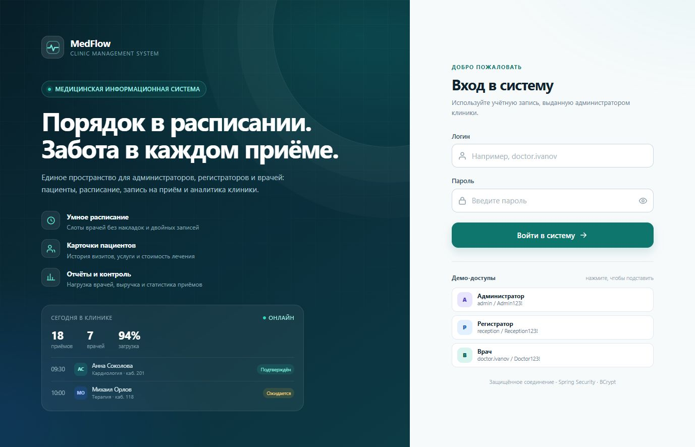
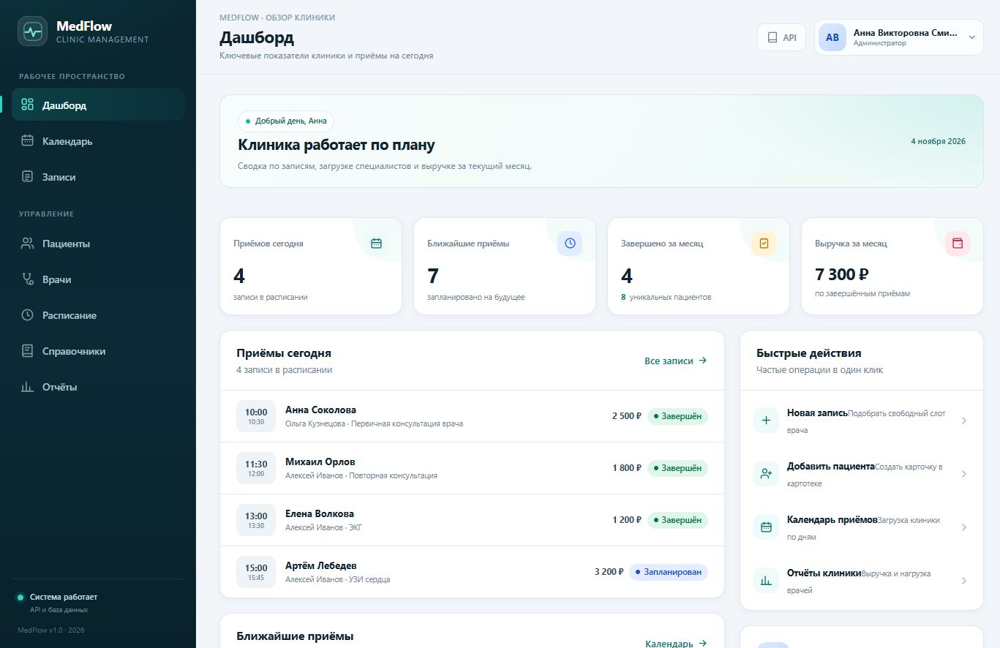
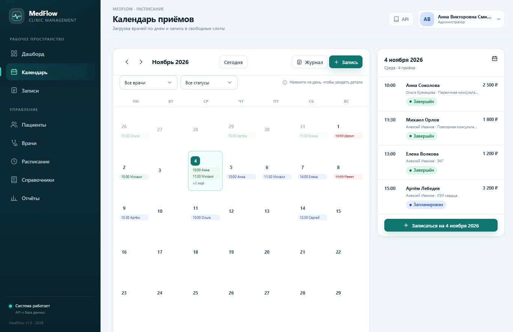
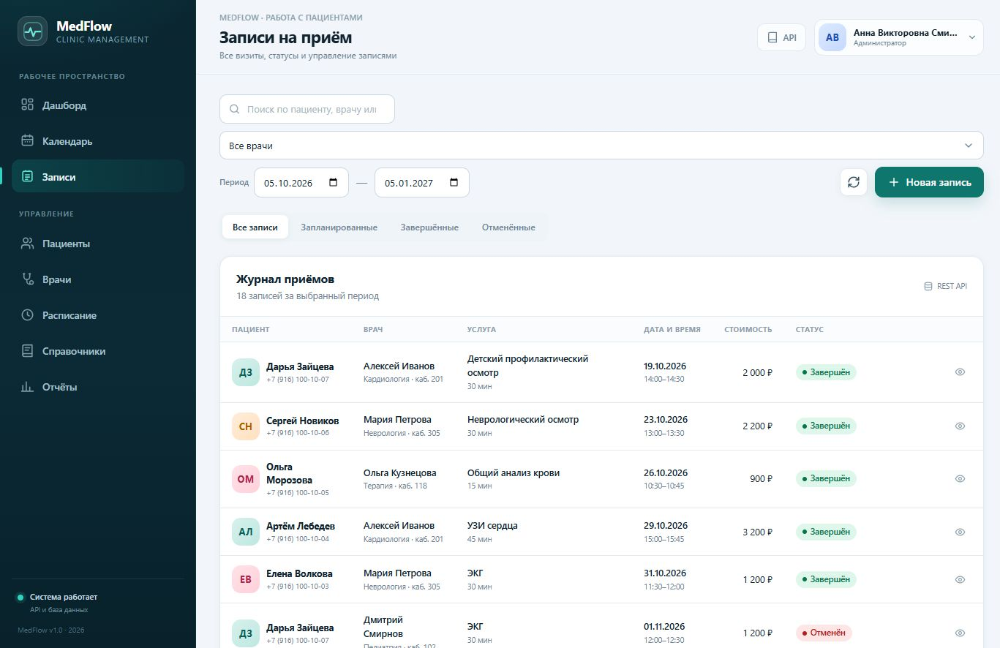
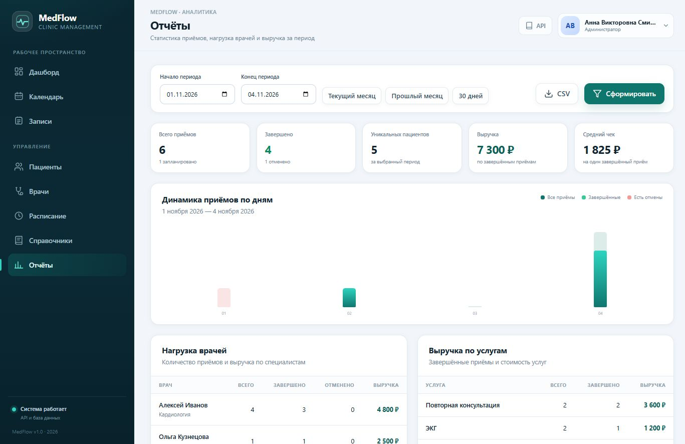
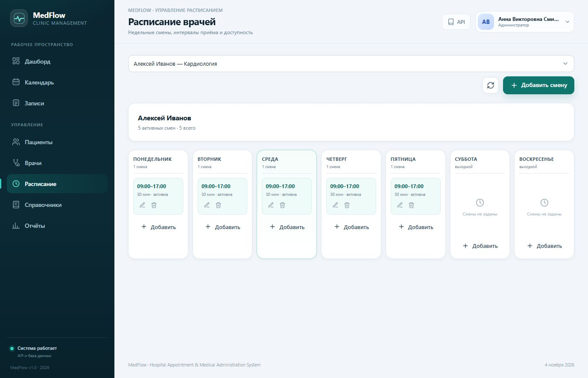
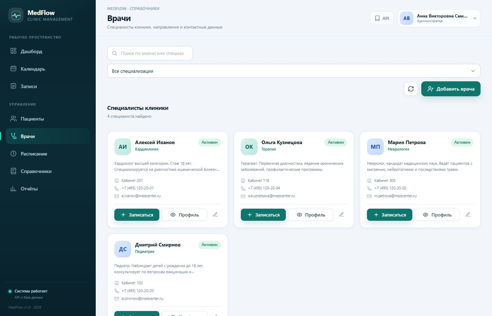
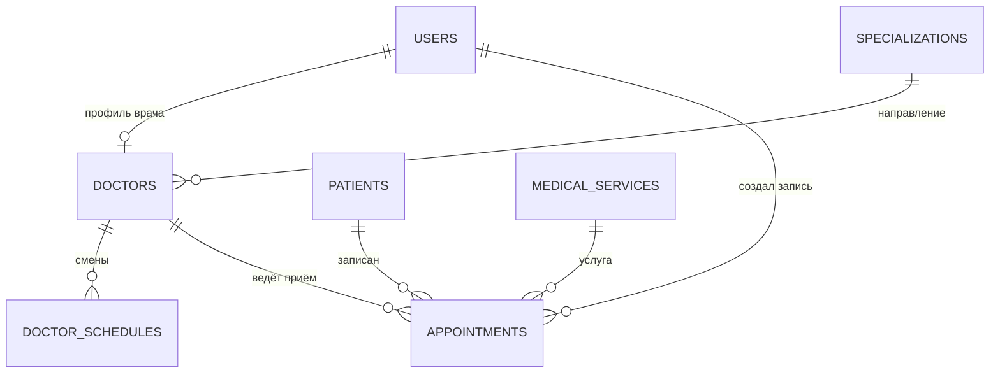

# MedFlow — Hospital Appointment and Medical Administration System


Full-stack-приложение для автоматизации работы небольшой клиники: пациенты, врачи
и их специализации, недельное расписание, запись на приём, медицинские услуги,
стоимость лечения и аналитические отчёты.

Проект построен на Spring Boot и MySQL, а клиентская часть — адаптивное SPA
на чистом JavaScript, которое работает с сервером только через REST API.



## Содержание

- [Возможности](#возможности)
- [Скриншоты](#скриншоты)
- [Технологии](#технологии)
- [Архитектура](#архитектура)
- [Роли и доступ](#роли-и-доступ)
- [Логика записи на приём](#логика-записи-на-приём)
- [Быстрый старт](#быстрый-старт)
- [Демо-доступы](#демо-доступы)
- [Тесты](#тесты)
- [REST API](#rest-api)
- [База данных](#база-данных)
- [Структура проекта](#структура-проекта)
- [Документация](#документация)

## Возможности

- **Роли и безопасность.** Администратор, регистратор и врач. Сессионная
  аутентификация Spring Security, пароли в BCrypt, CSRF-защита, серверные
  проверки ролей и владельца записи.
- **Пациенты.** Создание, редактирование, удаление, поиск по ФИО, телефону и
  email, карточка с возрастом и контактными данными.
- **Врачи и специализации.** Управление профилями врачей, специализациями,
  кабинетами и учётными записями. Врач создаётся вместе с пользователем системы.
- **Расписание.** Недельные смены врача с настраиваемым шагом слотов
  (10–120 минут), проверкой пересечений и возможностью отключить смену.
- **Календарь.** Месячная сетка приёмов с фильтрами, быстрым созданием записи,
  переносом и отменой из интерфейса.
- **Запись на приём.** Расчёт свободных слотов с учётом смены, длительности
  услуги, текущего времени и уже занятых интервалов.
- **Защита от двойной записи.** Серверная проверка пересечений, пессимистическая
  блокировка врача, уникальный индекс в БД и тест конкурентных запросов.
- **Статусы приёма.** `SCHEDULED`, `COMPLETED`, `CANCELLED`; отмена освобождает
  слот, завершение фиксирует фактическое оказание услуги.
- **Услуги и стоимость.** Прайс медицинских услуг, длительность, снимок цены в
  момент записи, выручка по завершённым приёмам.
- **Отчёты.** Количество приёмов, распределение по статусам, уникальные
  пациенты, нагрузка по врачам и специализациям, выручка по услугам и дням,
  экспорт CSV на клиенте.
- **Документация API.** Swagger UI / OpenAPI 3, подробный `docs/api.md`,
  Postman-коллекция с готовым сценарием авторизации.
- **Health-check.** `/api/health` и Spring Boot Actuator с проверкой БД.

## Скриншоты

| Вход | Дашборд |
|---|---|
|  |  |

| Календарь | Журнал записей |
|---|---|
|  |  |

| Отчёты | Расписание врачей |
|---|---|
|  |  |

| Врачи |
|---|
|  |

## Технологии

| Слой | Технологии |
|---|---|
| Backend | Java 17, Spring Boot 3.3.5, Spring Web MVC, Spring Data JPA, Hibernate, Bean Validation |
| Безопасность | Spring Security, сессии, BCrypt, CSRF cookie (`XSRF-TOKEN`) |
| База данных | MySQL 8.x, Flyway, H2 (демо и тесты), HikariCP |
| Frontend | HTML5, CSS3, JavaScript ES2022, Fetch API, SPA без сборщика |
| Документация | springdoc-openapi 2.6.0, Swagger UI, Markdown, Mermaid, Postman |
| Тесты | JUnit 5, Spring Boot Test, MockMvc, H2 |
| Сборка | Maven Wrapper 3.9.9, Spring Boot Maven Plugin |

## Архитектура

Приложение разделено на три слоя:

1. **Controller** — REST-контроллеры, валидация запросов, HTTP-статусы и Location.
2. **Service** — бизнес-правила, транзакции, проверка ролей и владельца,
   расчёт слотов, стоимости и отчётов.
3. **Repository** — Spring Data JPA-репозитории, блокировки и агрегирующие запросы.

Доменная модель состоит из 7 связанных сущностей: `User`, `Specialization`,
`Doctor`, `DoctorSchedule`, `Patient`, `MedicalService`, `Appointment`.
Схема создаётся миграциями Flyway, JPA работает в режиме `validate`.

```text
HTTP / JSON
    │
    ▼
Spring Security ──► Controller ──► Service ──► Repository ──► MySQL
    │                   │             │            │
  CSRF, роли       валидация     транзакции    JPA, блокировки
    │                   │             │            │
    └───────────────► SPA (HTML/CSS/JS, Fetch API) ◄┘
```

Клиент не содержит бизнес-логики записи: доступность, конфликты, цена и
разрешённые действия всегда пересчитываются на сервере.

## Роли и доступ

| Возможность | ADMIN | RECEPTIONIST | DOCTOR |
|---|:---:|:---:|:---:|
| Дашборд | все данные | все данные | только свои приёмы |
| Пациенты: чтение и изменение | да | да | нет |
| Врачи и специализации: чтение | да | да | да |
| Врачи и специализации: изменение | да | нет | нет |
| Расписание: чтение | да | да | только своё |
| Расписание: изменение | да | нет | нет |
| Записи: чтение | все | все | только свои |
| Записи: создание и перенос | да | да | нет |
| Записи: завершение | да | нет | только свои |
| Записи: отмена | да | да | только свои |
| Услуги: изменение | да | нет | нет |
| Отчёты | да | да | нет |

Регистратор не видит раздел расписания в интерфейсе, но чтение расписания
доступно ему через API. Врач не может открыть чужую запись или завершить
приём другого врача — это проверяется и в UI, и на сервере.

## Логика записи на приём

Создание и перенос записи выполняются в транзакции `READ_COMMITTED`:

1. Строка врача блокируется через `SELECT ... FOR UPDATE`
   (`DoctorRepository.findByIdForUpdate`).
2. Проверяется, что время в будущем, попадает в активную смену врача и
   выровнено по шагу слотов.
3. Проверяется пересечение интервала с активными приёмами врача; отменённые
   приёмы (`CANCELLED`) слот не занимают.
4. Рассчитывается `endTime` по длительности услуги, цена сохраняется в записи.
5. Уникальный индекс `(doctor_id, start_time, status)` служит последней линией
   защиты от дубля на уровне БД.

Такая схема защищает от гонки двух одновременных записей на один слот.
Отдельный интеграционный тест запускает два параллельных бронирования и
проверяет, что создаётся ровно одна запись.

Свободные слоты отдаёт `GET /api/doctors/{doctorId}/availability`; при переносе
параметр `excludeAppointmentId` исключает текущую запись из проверки.

## Быстрый старт

### Требования

- JDK 17 или 21;
- Docker Desktop — для варианта с MySQL;
- Maven не обязателен: в репозитории есть Maven Wrapper 3.9.9.

### Вариант 1. Демо на H2 (самый быстрый)

H2 хранит данные в памяти, схема и демо-данные создаются при старте:

```powershell
.\mvnw.cmd spring-boot:run "-Dspring-boot.run.profiles=demo"
```

Linux/macOS:

```bash
./mvnw spring-boot:run -Dspring-boot.run.profiles=demo
```

Приложение: <http://localhost:8080>

Или после сборки JAR:

```powershell
.\mvnw.cmd -DskipTests package
java -jar target/hospital-appointment-system-1.0.0.jar --spring.profiles.active=demo
```

### Вариант 2. MySQL 8 через Docker

```bash
docker compose up -d
```

Контейнер создаёт базу `hospital_db`, пользователя `hospital` и пароль
`hospital_pass`. Затем запустите приложение (профиль `mysql` используется по
умолчанию):

```powershell
.\mvnw.cmd spring-boot:run
```

Flyway применит `V1__create_schema.sql` и `V2__seed_data.sql`. Приложение будет
доступно на <http://localhost:8080>.

Если MySQL установлен локально, создайте базу и пользователя:

```sql
CREATE DATABASE hospital_db CHARACTER SET utf8mb4 COLLATE utf8mb4_unicode_ci;
CREATE USER 'hospital'@'%' IDENTIFIED BY 'hospital_pass';
GRANT ALL PRIVILEGES ON hospital_db.* TO 'hospital'@'%';
```

Параметры подключения можно переопределить переменными окружения:

| Переменная | Значение по умолчанию |
|---|---|
| `DB_URL` | `jdbc:mysql://localhost:3306/hospital_db?useSSL=false&allowPublicKeyRetrieval=true&serverTimezone=Europe/Moscow&characterEncoding=UTF-8` |
| `DB_USERNAME` | `hospital` |
| `DB_PASSWORD` | `hospital_pass` |
| `SERVER_PORT` | `8080` |
| `SPRING_PROFILES_ACTIVE` | `mysql` |

Пример для PowerShell с другим портом:

```powershell
$env:SERVER_PORT = "8081"
java -jar target/hospital-appointment-system-1.0.0.jar --spring.profiles.active=mysql
```

### После запуска

| Ресурс | Адрес |
|---|---|
| SPA | <http://localhost:8080> |
| Swagger UI | <http://localhost:8080/swagger-ui/index.html> |
| OpenAPI JSON | <http://localhost:8080/v3/api-docs> |
| Health-check | <http://localhost:8080/api/health> |
| Actuator | <http://localhost:8080/actuator/health> |

## Демо-доступы

| Роль | Логин | Пароль |
|---|---|---|
| Администратор | `admin` | `Admin123!` |
| Регистратор | `reception` | `Reception123!` |
| Врач (кардиолог) | `doctor.ivanov` | `Doctor123!` |
| Врач (невролог) | `doctor.petrova` | `Doctor123!` |
| Врач (педиатр) | `doctor.smirnov` | `Doctor123!` |
| Врач (терапевт) | `doctor.kuznetsova` | `Doctor123!` |

Демо-набор содержит 4 врачей, 5 специализаций, 12 пациентов, 8 услуг,
19 смен расписания и 18 приёмов с разными статусами. Даты приёмов в MySQL
рассчитываются относительно даты применения миграции, поэтому календарь и
отчёты остаются наполненными после первого запуска.

## Тесты

```powershell
.\mvnw.cmd test
```

В проекте 25 автоматических тестов, включая позитивные и негативные сценарии:

| Набор | Проверяет |
|---|---|
| `AppointmentServiceIntegrationTest` (16) | бронирование, конфликт интервалов, время вне смены, неверное выравнивание, прошлое время, отсутствие смены, доступность слотов, отмену и освобождение слота, перенос, завершение приёма, права врача и регистратора, запрет удаления пациента с историей, агрегацию отчёта |
| `AppointmentConcurrencyIntegrationTest` (1) | два одновременных запроса на один слот создают ровно одну запись |
| `ApiSecurityIntegrationTest` (8) | 401 для анонимного API, запрет пациента и отчётов для врача, запрет создания врача регистратором, доступ администратора к отчётам, обязательный CSRF для POST, публичный health, доступ врача к своим записям |

Тесты используют H2 в режиме совместимости с MySQL и не требуют запущенной
базы данных.

## REST API

Подробное описание с примерами запросов и ответов: [`docs/api.md`](docs/api.md).
Готовая Postman-коллекция: [`docs/postman/Hospital-API.postman_collection.json`](docs/postman/Hospital-API.postman_collection.json).

Краткий перечень:

| Группа | Основные методы |
|---|---|
| Аутентификация | `GET /api/auth/csrf`, `POST /api/auth/login`, `GET /api/auth/me`, `POST /api/auth/logout` |
| Пациенты | `GET/POST /api/patients`, `GET/PUT/DELETE /api/patients/{id}` |
| Врачи | `GET/POST /api/doctors`, `GET/PUT/DELETE /api/doctors/{id}` |
| Специализации | `GET/POST /api/specializations`, `GET/PUT/DELETE /api/specializations/{id}` |
| Расписание | `GET/POST /api/doctors/{id}/schedules`, `PUT/DELETE /api/schedules/{id}` |
| Доступность | `GET /api/doctors/{id}/availability?date=...` |
| Записи | `GET/POST /api/appointments`, `PUT /api/appointments/{id}/reschedule`, `POST /api/appointments/{id}/complete`, `POST /api/appointments/{id}/cancel` |
| Услуги | `GET/POST /api/services`, `GET/PUT/DELETE /api/services/{id}` |
| Отчёты | `GET /api/reports?from=...&to=...` |
| Служебные | `GET /api/health`, `GET /api/dashboard` |

Авторизация в API:

1. `GET /api/auth/csrf` — получить cookie `XSRF-TOKEN` и токен.
2. `POST /api/auth/login` с заголовком `X-XSRF-TOKEN` и телом
   `{"username": "...", "password": "..."}`.
3. Передавать cookie сессии и CSRF-заголовок во всех изменяющих запросах.

## База данных

ER-диаграмма, ограничения и объяснение защиты от двойной записи:
[`docs/er-diagram.md`](docs/er-diagram.md).



Миграции:

- [`V1__create_schema.sql`](src/main/resources/db/migration/V1__create_schema.sql) —
  таблицы, внешние ключи, индексы и ограничения;
- [`V2__seed_data.sql`](src/main/resources/db/migration/V2__seed_data.sql) —
  демонстрационные данные, согласованные с расписанием врачей.

## Структура проекта

```text
├── docs/
│   ├── api.md                  # REST API и примеры
│   ├── er-diagram.md           # ER-диаграмма и ограничения
│   ├── postman/                # коллекция запросов
│   └── screenshots/            # скриншоты интерфейса
├── src/main/java/com/ward/hospital/
│   ├── config/                 # security, OpenAPI, демо-данные
│   ├── controller/             # REST-контроллеры
│   ├── domain/                 # JPA-сущности и enum
│   ├── dto/                    # запросы и ответы API
│   ├── exception/              # бизнес-исключения и JSON-ошибки
│   ├── repository/             # Spring Data JPA
│   ├── security/               # UserDetails, текущий пользователь
│   ├── service/                # бизнес-логика
│   └── util/
├── src/main/resources/
│   ├── db/migration/           # Flyway
│   ├── static/                 # SPA: HTML, CSS, JavaScript
│   └── application*.yml        # mysql, demo, test
├── src/test/java/              # интеграционные тесты
├── docker-compose.yml          # MySQL 8.4
├── mvnw / mvnw.cmd             # Maven Wrapper
└── pom.xml
```

## Документация

- [REST API](docs/api.md) — эндпоинты, коды ответов, примеры, матрица ролей.
- [ER-диаграмма](docs/er-diagram.md) — схема БД и конкурентный доступ.
- [Postman-коллекция](docs/postman/Hospital-API.postman_collection.json) —
  авторизация, CRUD, расписание, доступность, записи и отчёты.
- Swagger UI — после запуска: <http://localhost:8080/swagger-ui/index.html>.

## Примечания

Проект предназначен для демонстрации полного цикла разработки и использует
только тестовые данные. Перед production-развёртыванием следует включить HTTPS,
вынести секреты из конфигурации, настроить резервное копирование MySQL и
ограничить доступ к Actuator/Swagger.
