# ER-диаграмма базы данных

Проект использует 8 связанных таблиц. Базовая схема создаётся миграцией
`V1__create_schema.sql`, демонстрационные данные — `V2__seed_data.sql`,
расширение для личного кабинета и направлений — `V3__patient_portal_and_referrals.sql`.
Все миграции лежат в `src/main/resources/db/migration/`; `V1` и `V2` при
расширении остались без изменений.

```mermaid
erDiagram
    USERS ||--o| DOCTORS : "профиль врача"
    USERS ||--o| PATIENTS : "личный кабинет"
    USERS ||--o{ APPOINTMENTS : "создал запись"
    SPECIALIZATIONS ||--o{ DOCTORS : "направление"
    DOCTORS ||--o{ DOCTOR_SCHEDULES : "недельные смены"
    DOCTORS ||--o{ APPOINTMENTS : "ведёт приём"
    PATIENTS ||--o{ APPOINTMENTS : "записан на приём"
    MEDICAL_SERVICES ||--o{ APPOINTMENTS : "услуга приёма"
    PATIENTS ||--o{ REFERRALS : "пациент"
    DOCTORS ||--o{ REFERRALS : "выписал"
    DOCTORS |o--o{ REFERRALS : "получатель"
    SPECIALIZATIONS |o--o{ REFERRALS : "адресат по специальности"
    APPOINTMENTS |o--o{ REFERRALS : "во время приёма"

    USERS {
        BIGINT id PK
        VARCHAR username UK
        VARCHAR password "BCrypt"
        VARCHAR full_name
        VARCHAR role_name "ADMIN | DOCTOR | RECEPTIONIST | PATIENT"
        BOOLEAN enabled
        DATETIME created_at
        DATETIME updated_at
    }

    SPECIALIZATIONS {
        BIGINT id PK
        VARCHAR name UK
        VARCHAR description
        BOOLEAN active
        DATETIME created_at
        DATETIME updated_at
    }

    DOCTORS {
        BIGINT id PK
        BIGINT user_id FK "UK, users.id"
        BIGINT specialization_id FK "specializations.id"
        VARCHAR first_name
        VARCHAR last_name
        VARCHAR email UK
        VARCHAR phone
        VARCHAR office
        VARCHAR bio
        BOOLEAN active
        DATETIME created_at
        DATETIME updated_at
    }

    DOCTOR_SCHEDULES {
        BIGINT id PK
        BIGINT doctor_id FK "doctors.id"
        VARCHAR day_of_week "MONDAY..SUNDAY"
        TIME start_time
        TIME end_time
        INT slot_minutes
        BOOLEAN active
        DATETIME created_at
        DATETIME updated_at
    }

    PATIENTS {
        BIGINT id PK
        VARCHAR iin UK "12 цифр, уникален"
        BIGINT user_id FK "UK, users.id, личный кабинет"
        VARCHAR first_name
        VARCHAR last_name
        DATE birth_date
        VARCHAR gender "MALE | FEMALE"
        VARCHAR phone
        VARCHAR email
        VARCHAR address
        DATETIME created_at
        DATETIME updated_at
    }

    MEDICAL_SERVICES {
        BIGINT id PK
        VARCHAR name UK
        VARCHAR description
        DECIMAL price
        INT duration_minutes
        BOOLEAN active
        DATETIME created_at
        DATETIME updated_at
    }

    APPOINTMENTS {
        BIGINT id PK
        BIGINT doctor_id FK "doctors.id"
        BIGINT patient_id FK "patients.id"
        BIGINT service_id FK "medical_services.id"
        DATETIME start_time
        DATETIME end_time
        VARCHAR status "SCHEDULED | COMPLETED | CANCELLED | NO_SHOW"
        DECIMAL price "снимок цены"
        VARCHAR notes
        VARCHAR cancellation_reason
        DATETIME completed_at
        DATETIME cancelled_at
        BIGINT created_by FK "users.id"
        BIGINT version "оптимистическая блокировка"
        DATETIME created_at
        DATETIME updated_at
    }

    REFERRALS {
        BIGINT id PK
        BIGINT patient_id FK "patients.id"
        BIGINT from_doctor_id FK "doctors.id"
        BIGINT to_doctor_id FK "doctors.id, nullable"
        BIGINT to_specialization_id FK "specializations.id, nullable"
        BIGINT appointment_id FK "appointments.id, nullable"
        VARCHAR department
        VARCHAR office
        VARCHAR reason
        VARCHAR status "PENDING | ACCEPTED | COMPLETED | CANCELLED"
        DATETIME decided_at
        DATETIME created_at
        DATETIME updated_at
    }
```

## Ключевые ограничения

| Таблица | Ограничение | Назначение |
|---|---|---|
| `users` | `uk_users_username` | уникальный логин |
| `patients` | `uk_patients_iin` | уникальный ИИН (12 цифр) |
| `patients` | `uk_patients_user`, `fk_patients_user` | один личный кабинет на пациента |
| `patients` | `address NOT NULL` | обязательный адрес проживания |
| `doctors` | `uk_doctors_user`, `uk_doctors_email` | один профиль на пользователя, уникальный email |
| `doctor_schedules` | `uk_doctor_schedules_day` | одна активная смена врача на день недели |
| `medical_services` | `uk_medical_services_name` | уникальное название услуги |
| `appointments` | `uk_appointments_doctor_slot_status` | защита от дубля слота на уровне БД |
| `appointments` | `version` (`@Version`) | оптимистическая блокировка при изменении |
| `appointments` | индексы по врачу, пациенту и статусу | быстрые выборки календаря и отчётов |
| `referrals` | `fk_referrals_patient`, `fk_referrals_from_doctor`, `fk_referrals_appointment` | целостность пациента, автора и приёма |
| `referrals` | `fk_referrals_to_doctor`, `fk_referrals_to_specialization` | адресат направления |
| `referrals` | `ck_referrals_target` | ровно один адресат: врач или специальность |
| `referrals` | индексы по пациенту, врачу-получателю, специальности и статусу | быстрые выборки входящих и личного кабинета |

## Почему защита от двойной записи работает

1. При создании или переносе приёма сервис блокирует строку врача:
   `DoctorRepository.findByIdForUpdate` (`SELECT ... FOR UPDATE`).
2. Под блокировкой выполняется проверка пересечения интервала с существующими
   приёмами врача, кроме `CANCELLED` и, при переносе, кроме самой записи.
3. Дополнительно уникальный индекс `(doctor_id, start_time, status)` не даёт
   сохранить два одинаковых слота даже при ошибке в прикладной логике.
4. Транзакция создания/переноса работает на уровне `READ_COMMITTED`, чтобы
   проверка видела только что зафиксированные записи других транзакций.

Отменённые приёмы сохраняются в истории, но не занимают слот: слот снова
становится доступным для записи. Статус `NO_SHOW` также сохраняется в истории
и не участвует в расчёте выручки.

## Направления

`referrals` — централизованное хранилище электронных направлений. Связь с
`appointments` необязательна (`NULL` допустим), но при создании через API
приём обязателен: сервис берёт из него пациента и врача-автора.

Адресат задаётся одним из двух способов:

- `to_doctor_id` — направление попадает только к этому врачу;
- `to_specialization_id` при `to_doctor_id IS NULL` — направление видят все
  врачи указанной специализации.

Проверка `ck_referrals_target` не даёт сохранить направление без адресата или с
двумя адресатами одновременно. Статусы меняются по правилу
`PENDING → ACCEPTED | CANCELLED`, `ACCEPTED → COMPLETED | CANCELLED`;
`COMPLETED` и `CANCELLED` — терминальные.

Миграция `V3` добавляет колонки в существующие таблицы и демонстрационные
записи; `V1` и `V2` не переписывались, поэтому уже работающую базу можно
обновить обычным Flyway-апгрейдом.
