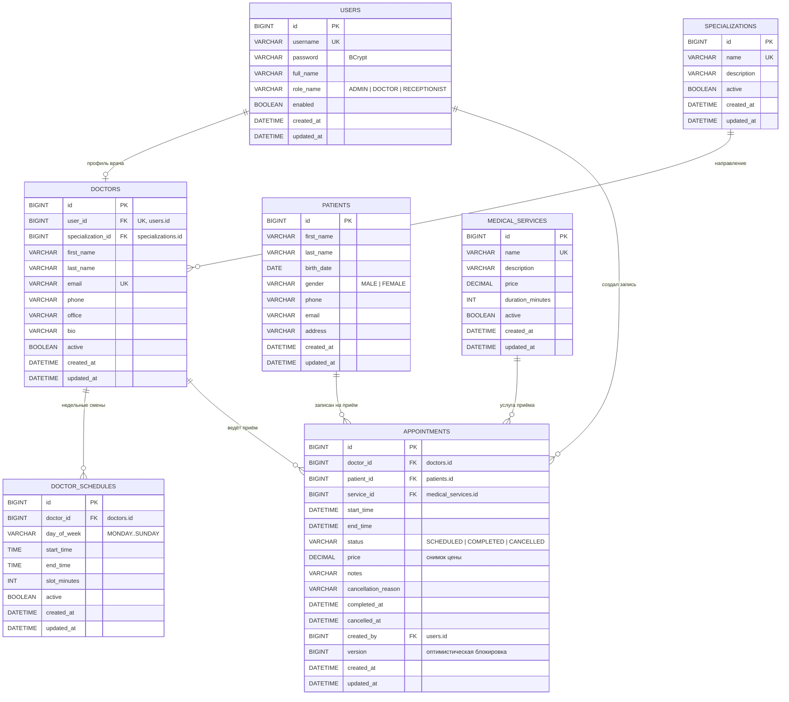

# ER-диаграмма базы данных

Проект использует 7 связанных таблиц. Схема создаётся миграцией
`src/main/resources/db/migration/V1__create_schema.sql`, демонстрационные данные —
`V2__seed_data.sql`.

## Ключевые ограничения

| Таблица | Ограничение | Назначение |
|---|---|---|
| `users` | `uk_users_username` | уникальный логин |
| `doctors` | `uk_doctors_user`, `uk_doctors_email` | один профиль на пользователя, уникальный email |
| `doctor_schedules` | `uk_doctor_schedules_day` | одна активная смена врача на день недели |
| `medical_services` | `uk_medical_services_name` | уникальное название услуги |
| `appointments` | `uk_appointments_doctor_slot_status` | защита от дубля слота на уровне БД |
| `appointments` | `version` (`@Version`) | оптимистическая блокировка при изменении |
| `appointments` | индексы по врачу, пациенту и статусу | быстрые выборки календаря и отчётов |

## Почему защита от двойной записи работает

1. При создании или переносе приёма сервис блокирует строку врача:
   `DoctorRepository.findByIdForUpdate` (`SELECT ... FOR UPDATE`).
2. Под блокировкой выполняется проверка пересечения интервала с существующими
   приёмами врача, кроме `CANCELLED` и, при переносе, кроме самой записи.
3. Дополнительно уникальный индекс `(doctor_id, start_time, status)` не даёт
   сохранить два одинаковых слота даже при ошибке в прикладной логике.
4. Транзакция создания/переноса работает на уровне `READ_COMMITTED`, чтобы
   проверка видела только что зафиксированные записи других транзакций.

Отменённые приёмы сохраняются в истории, но не занимают слот: слот снова
становится доступным для записи.
